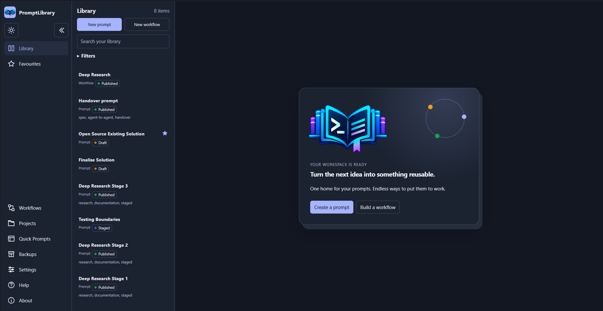
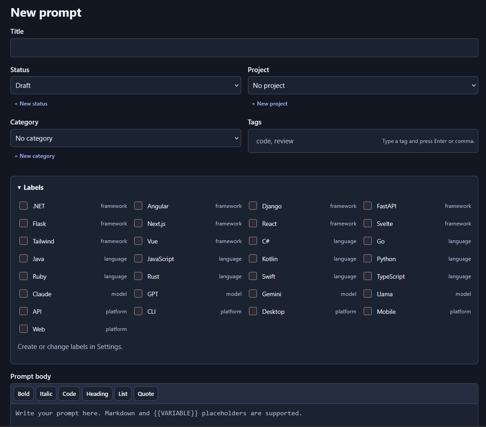
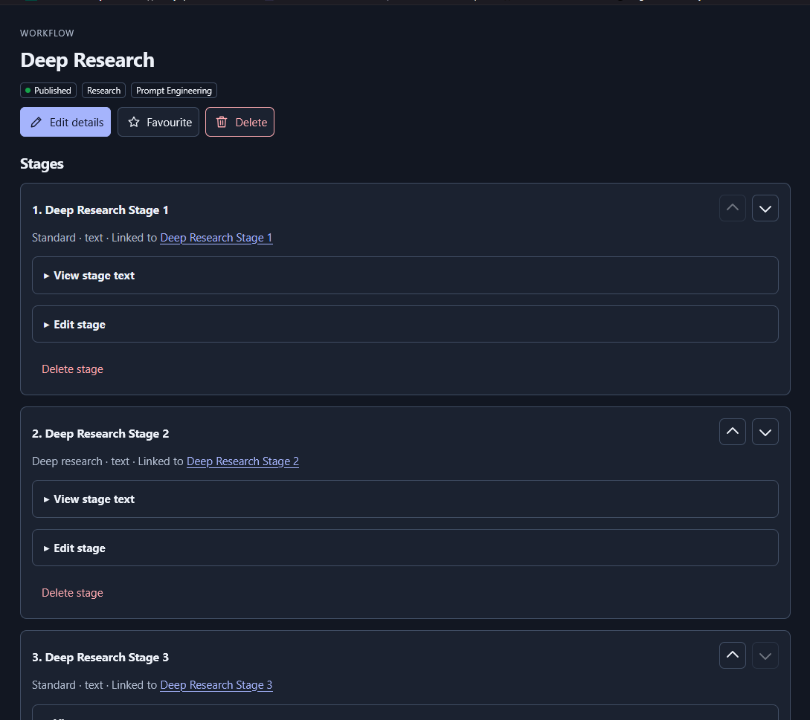
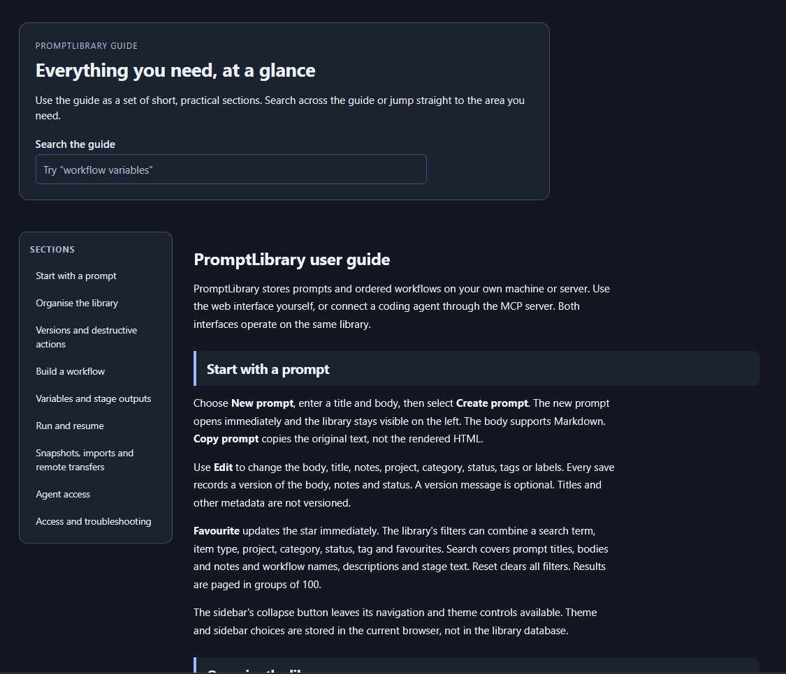
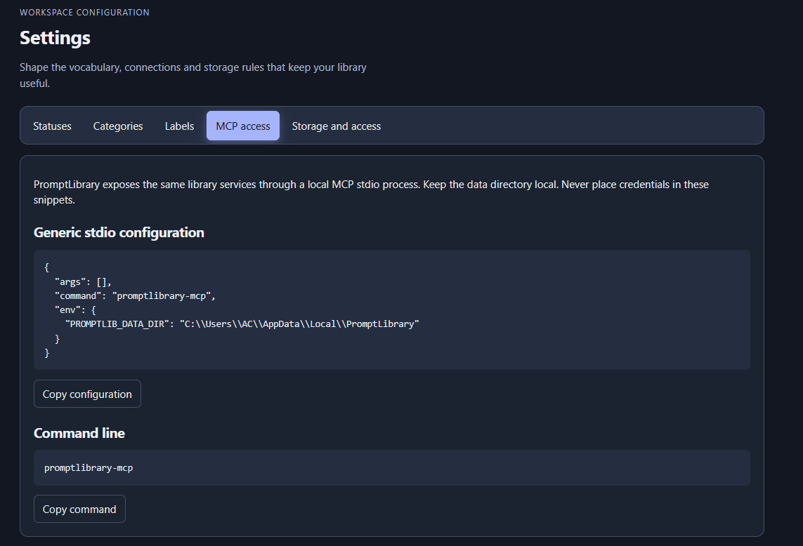

# PromptLibrary

[](https://github.com/thecodingrasta/PromptLibrary/actions/workflows/ci.yml)
[](https://github.com/thecodingrasta/PromptLibrary/releases)
[](LICENSE)
[](https://www.python.org/)
[](docs/mcp.md)

**One home for your prompts. Endless ways to put them to work.**

PromptLibrary is a self-hosted library for prompts and ordered workflows. It combines a browser interface for people with a local [Model Context Protocol (MCP)](docs/mcp.md) server for agents. Your content stays in SQLite on your machine or server: no account, cloud subscription, or model provider is required.

> **Status:** PromptLibrary is actively maintained. Read the [changelog](CHANGELOG.md), [release checks](docs/releasing.md) and [security boundary](SECURITY.md) before adopting it for important data.

<p align="center">
  <a href="assets/screenshots/main-view.png"></a>
</p>

<details>
<summary><strong>Jump to a section</strong></summary>

- [What it does](#what-it-does)
- [Screenshots](#screenshots)
- [What it deliberately does not do](#what-it-deliberately-does-not-do)
- [Use cases](#use-cases)
- [Download and run](#download-and-run)
- [Run from source](#run-from-source)
- [First steps](#first-steps)
- [Workflows and guided runs](#workflows-and-guided-runs)
- [MCP access](#mcp-access)
- [Backups, imports and upgrades](#backups-imports-and-upgrades)
- [Configuration](#configuration)
- [Docker](#docker)
- [Development and testing](#development-and-testing)
- [Architecture](#architecture)
- [Security and privacy](#security-and-privacy)
- [Contributing](#contributing)
- [Support and licence](#support-and-licence)

</details>

## What it does

- **Organise prompts and workflows together.** Search and filter by type, project, category, tag, status, or favourite; create custom statuses and typed labels.
- **Preserve useful history.** Compare prompt versions, restore earlier content, or clear history deliberately.
- **Compose dependable workflows.** Build stages from copied or live-linked prompts and reorder them without silently changing output dependencies.
- **Run work step by step.** Supply inputs, copy each rendered stage into the tool or provider you choose, save its output and continue from a stored run snapshot.
- **Keep data portable.** Export and restore complete JSON or XML snapshots, or configure local-folder, WebDAV, SFTP and S3-compatible backups.
- **Connect agents through MCP.** The browser and MCP interfaces use the same services, validation, transactions and SQLite data.
- **Work locally on desktop or server.** Windows provides an optional branded notification-area controller; Linux and macOS can run the browser server directly or under an operating-system service manager.

## Screenshots

Select any image to view it at full size.

<table>
  <tr>
    <td width="50%" valign="top">
      <a href="assets/screenshots/new-prompt.png"></a>
      <br><sub><strong>Write prompts.</strong> Organise with statuses, projects, categories, tags and typed labels, then edit the Markdown body with <code>{{VARIABLE}}</code> placeholders.</sub>
    </td>
    <td width="50%" valign="top">
      <a href="assets/screenshots/workflows.png"></a>
      <br><sub><strong>Compose workflows.</strong> Order stages, link them to live prompts and keep output references aligned when you reorder.</sub>
    </td>
  </tr>
  <tr>
    <td width="50%" valign="top">
      <a href="assets/screenshots/help-guide.png"></a>
      <br><sub><strong>Learn in the app.</strong> The built-in guide is searchable and split into short sections with a sticky contents list.</sub>
    </td>
    <td width="50%" valign="top">
      <a href="assets/screenshots/mcp-access.png"></a>
      <br><sub><strong>Connect agents.</strong> Copy a ready-made <a href="docs/mcp.md">MCP</a> stdio configuration from Settings.</sub>
    </td>
  </tr>
</table>

## What it deliberately does not do

PromptLibrary does **not** call models, execute shell commands, schedule agents, merge concurrent remote edits, provide multi-user permissions, or run workflow stages autonomously. Stage modes and output types are guidance for the human or agent operating each stage, not provider settings or output enforcement.

See the [user guide](src/promptlibrary/content/user-guide.md) for the complete user-facing walkthrough.

## Use cases

| Use case | Support |
| --- | --- |
| Personal prompt and workflow library | Supported |
| Versioned prompt editing and review | Supported |
| Guided, human- or agent-operated workflows | Supported |
| Local and remote snapshot backups | Supported |
| Local MCP access for coding agents | Supported |
| Single-operator self-hosted deployment | Supported |
| Multi-user roles, tenants, or audit-grade activity history | Not provided |
| Built-in model inference or autonomous execution | Not provided |
| Automatic bidirectional synchronisation | Not provided |

## Download and run

Every [release](https://github.com/thecodingrasta/PromptLibrary/releases/latest) includes a standalone executable for Windows (x64), Linux (x64 and arm64) and macOS (Apple silicon). It bundles Python and every dependency, so there is nothing to install: download the file for your system, then run it.

| System | CPU | File to download |
| --- | --- | --- |
| Windows 10 or 11 | Intel or AMD (x64) | `promptlibrary-<version>-windows-x64.exe` |
| Linux (glibc 2.35 or newer) | Intel or AMD (x64) | `promptlibrary-<version>-linux-x64` |
| Linux (glibc 2.35 or newer) | Arm (arm64) | `promptlibrary-<version>-linux-arm64` |
| macOS | Apple silicon (arm64) | `promptlibrary-<version>-macos-arm64` |

**Windows on Arm and Intel Macs:** there is no standalone executable for these two yet, because the `cryptography` package does not publish a patched build for them. Use the [Python route](#run-from-source) (`python -m pip install` of the wheel from the release) or the [Docker image](#docker). Both work on those systems.

Not sure which CPU you have? On Windows run `$env:PROCESSOR_ARCHITECTURE` in PowerShell (`AMD64` is x64). On Linux and macOS run `uname -m` (`x86_64` is x64, and `arm64` or `aarch64` is arm64).

Each release also lists `SHA256SUMS.txt`, the Python wheel (`.whl`) and the source archive (`.tar.gz`). The wheel and source archive are for people who already use Python; most people only need the executable.

<details open>
<summary><strong>Windows</strong></summary>

Double-click the downloaded `.exe`, or run it from PowerShell:

```powershell
.\promptlibrary-<version>-windows-x64.exe
```

PromptLibrary opens no terminal window. It adds a branded icon to the notification area (check the hidden-icons menu) and shows a notification with the address, which is `http://127.0.0.1:8000` unless that port is busy. The icon menu opens PromptLibrary, stops its web server or quits the controller. If another application already uses port 8000, PromptLibrary attaches to its own running instance or picks the next free port from 8001.

The executable is not code-signed yet, so Windows SmartScreen may show **Windows protected your PC**. Choose **More info**, then **Run anyway**, after you have checked the file against `SHA256SUMS.txt`.

The same file provides the command-line tools. Run these from PowerShell:

```powershell
.\promptlibrary-<version>-windows-x64.exe --version
.\promptlibrary-<version>-windows-x64.exe maintenance doctor
.\promptlibrary-<version>-windows-x64.exe mcp --print-config
```

</details>

<details>
<summary><strong>Linux</strong></summary>

Browsers do not keep the executable permission on downloaded files, so set it first:

```sh
chmod +x promptlibrary-*-linux-x64
./promptlibrary-*-linux-x64
```

Open `http://127.0.0.1:8000` in the browser of your choice. The server runs in the terminal; press Ctrl+C to stop it. To keep it running in the background, use `systemd`, `tmux` or another service manager.

The Linux executables need glibc 2.35 or newer, which covers Ubuntu 22.04 and later, Debian 12 and later, Fedora and most current distributions. They do not run on musl-based systems such as Alpine; use the [Docker image](#docker) there.

</details>

<details>
<summary><strong>macOS</strong></summary>

```sh
chmod +x promptlibrary-*-macos-arm64
./promptlibrary-*-macos-arm64
```

Open `http://127.0.0.1:8000` in your browser. The server runs in the terminal; press Ctrl+C to stop it.

The executables are not signed or notarised by Apple. If macOS says it cannot verify the developer, remove the download quarantine flag after you have checked the file against `SHA256SUMS.txt`:

```sh
xattr -d com.apple.quarantine promptlibrary-*-macos-arm64
```

You can also open **System Settings**, then **Privacy & Security**, and choose **Open Anyway** after the first blocked attempt.

</details>

<details>
<summary><strong>Verify your download</strong></summary>

Download `SHA256SUMS.txt` next to the file and compare the hashes.

```powershell
# Windows
Get-FileHash .\promptlibrary-<version>-windows-x64.exe -Algorithm SHA256
```

```sh
# Linux
sha256sum --ignore-missing -c SHA256SUMS.txt
# macOS
shasum -a 256 --ignore-missing -c SHA256SUMS.txt
```

On Windows, compare the printed hash with the matching line in `SHA256SUMS.txt`.

</details>

### Using the executable

The executable is one program with subcommands. With no subcommand it starts the web interface.

| Command | Purpose |
| --- | --- |
| `promptlibrary` | Start the web interface (the tray controller on Windows) |
| `promptlibrary serve` | Run the web server in this terminal, never the tray |
| `promptlibrary mcp` | Run the [MCP](docs/mcp.md) stdio server for coding agents |
| `promptlibrary mcp --print-config` | Print an MCP client configuration that points at this file |
| `promptlibrary maintenance doctor` | Check the database without changing it |
| `promptlibrary self-check` | Confirm this file contains every module and resource it needs |
| `promptlibrary --version` | Print the version |

Your library is stored in a per-user data directory, not next to the executable. Moving or replacing the executable does not move your data. Settings come from `PROMPTLIB_*` environment variables or a `.env` file in the directory you start it from; see [Configuration](docs/configuration.md).

To connect an agent, open **Settings**, then **MCP access**. It shows a configuration that already names your executable, or run `promptlibrary mcp --print-config`.

## Run from source

Use this route to contribute or to run the latest unreleased code. Install Python 3.12 or newer, extract or clone the repository and open a terminal in its root. Installation downloads the declared Python packages; normal local use does not need an internet connection after setup.
<details open>
<summary><strong>Windows</strong></summary>

```powershell
py -3 scripts/manage.py setup
py -3 scripts/manage.py run
```

The Windows command returns after starting the branded PromptLibrary tray controller. The notification-area icon remains available whether the browser is open or closed and provides actions to open PromptLibrary, stop its owned web server, or quit the controller. The web server is a separately identifiable process. If the configured port is occupied, the controller attaches to an existing PromptLibrary instance or selects an available loopback port in the configured range.

</details>

<details>
<summary><strong>Linux and macOS</strong></summary>

```sh
python3 scripts/manage.py setup
python3 scripts/manage.py run
```

Open `http://127.0.0.1:8000` in the browser of your choice. Keep the terminal open and press Ctrl+C to stop the server. The commands create a checkout-local `.venv` without changing the system Python. The equivalent wrappers are `scripts/install.*`, `scripts/start.*` and `scripts/validate.*`.

</details>

<details>
<summary><strong>Installed package</strong></summary>

From a release, download the `.whl` file and install it with Python 3.12 or newer. This is the route for Windows on Arm and Intel Macs, which have no standalone executable:

```sh
python -m pip install ./promptlibrary-<version>-py3-none-any.whl
promptlibrary
```

On Windows, add the tray controller with `python -m pip install "./promptlibrary-<version>-py3-none-any.whl[desktop]"`.

From a checkout:

```sh
python -m pip install .
promptlibrary
```

On Windows, the repository setup command installs the optional desktop extra and the installed `promptlibrary` command starts the tray controller. On systems without a desktop tray, run the browser server under a terminal or service manager.

</details>

## First steps

1. Choose **New prompt**, enter a title and body and save it.
2. Add project, category, status, tags and labels as needed; inline creation is available while editing.
3. Use **Version history** to compare or restore content.
4. Choose **New workflow**, save its details and add copied or live-linked stages.
5. Enter variables such as `{{TOPIC}}`, then choose **Start guided run** and record each output.
6. Connect an agent through [MCP](docs/mcp.md) when you want tool-assisted library management.

Theme and sidebar preferences belong to the current browser. Library content remains on the configured server data directory.

## Workflows and guided runs

A stage can contain its own text, a copied prompt, or a live link to a prompt. A live-linked stage renders the current source body; detach it before editing a local copy. Stage order is dependency-aware: invalid self-references and later-stage references are refused and safe reordering keeps logical output references aligned.

A guided run snapshots the workflow and resolved linked prompts when it starts. For each stage, copy the rendered input to the provider or tool you choose, then paste the result back into PromptLibrary. Saved runs retain inputs and outputs even if the source workflow later changes.

Read the [user guide](src/promptlibrary/content/user-guide.md) for variables, output references, run recovery and destructive-action behavior.

## MCP access

The MCP server is a local stdio process that uses the same database and services as the browser. It does not require the HTTP server to be running and is not a remotely exposed endpoint.

```sh
promptlibrary-mcp --print-config
promptlibrary-mcp --print-tools
```

Register the printed configuration with your MCP client and give it the same `PROMPTLIB_DATA_DIR` as the browser application. Clients should call `tools/list` to discover current schemas. See [MCP usage](docs/mcp.md) and the generated [tool reference](docs/mcp-tools.md).

A connected client can read and change the entire single-operator library. Require operator approval for deletion, history clearing, replacement imports, remote configuration and remote writes.

## Backups, imports and upgrades

JSON and XML snapshots include prompts, versions, projects, categories, tags, labels, statuses, workflows, stages, runs, outputs and stored preferences. Credentials, startup configuration, browser preferences and the encryption key are intentionally excluded. Snapshots are plaintext and can contain notes and workflow outputs.

- **Merge** adds new records, skips identical records and refuses conflicting edits as one transaction.
- **Replace** restores a complete snapshot after creating a local safety copy; records absent from the snapshot are removed.
- **Remote push** replaces one configured remote snapshot. **Remote pull** uses the same merge or replace rules as local import.
- Portable snapshots are limited to 25 MiB. Use the native maintenance backup for larger libraries.

```sh
promptlibrary-maintenance doctor
promptlibrary-maintenance backup ./library-backup.db
```

Stop all web and MCP processes before restoring a native backup. See [operations and recovery](docs/operations.md) for migration, restore, rollback and remote-transfer details.

## Configuration

Copy `.env.example` to `.env`, or set `PROMPTLIB_` environment variables. Explicit environment variables take precedence. The default data directories are `%LOCALAPPDATA%/PromptLibrary` on Windows, `~/Library/Application Support/PromptLibrary` on macOS and `${XDG_DATA_HOME:-~/.local/share}/promptlibrary` on Linux.

The default listener is loopback-only. Network listening requires a strong password, explicit allowed hosts and HTTPS at a trusted reverse proxy. Do not expose the service to untrusted users. See [configuration](docs/configuration.md) and [security](SECURITY.md).

## Docker

Set a long `PROMPTLIB_AUTH_PASSWORD` in `.env`, then run:

```sh
docker compose up --build -d
```

The container runs as an unprivileged user, stores data in a named volume and publishes only a loopback port by default. `docker compose down` preserves the volume; `docker compose down -v` deletes it.

## Development and testing

Use the checkout-local environment and temporary data directories for all checks:

```sh
python scripts/manage.py setup --dev --browsers
python scripts/manage.py validate --browsers --security
python scripts/manage.py build
```

The validation command fails on missing tools or failed checks; it does not silently convert an unavailable environment into a pass. For a focused run inside the environment:

```sh
python -m ruff check .
python -m ruff format --check .
python -m mypy src/promptlibrary
python -m pytest -q --ignore=tests/e2e --ignore=tests/integration
python -m pytest -q tests/integration/test_mcp_stdio.py
python -m pytest -q tests/e2e --browser <installed-browser>
```

To build and test the standalone executable for your own platform:

```sh
python -m pip install -e ".[binary]"
python scripts/build_binary.py
python scripts/binary_smoke.py "dist-binary/promptlibrary-*"
```

PyInstaller cannot cross-compile, so each executable is built on a runner of its own operating system and CPU. See [docs/releasing.md](docs/releasing.md).

Choose any supported, installed Playwright browser for local journeys. CI covers native platforms, multiple browser engines, package installation and Docker smoke behavior. A workflow definition is not evidence that its job passed; release sign-off requires the exact-commit checks in [docs/releasing.md](docs/releasing.md).

## Architecture

```text
Browser UI ─┐
            ├─ shared services ─ SQLite data directory
MCP stdio ──┘          └─ snapshot sync providers
```

FastAPI routes and the MCP adapter translate transport requests into shared services. Services own validation, transactions, versions, workflow state, snapshots, metadata and remote configuration. SQLite uses foreign keys, single-writer transactions, schema migrations and safety backups. Sync providers implement local-folder, WebDAV, SFTP and S3-compatible snapshot transport.

Read the [architecture guide](docs/architecture.md) for data boundaries, failure behavior, portability and security invariants.

## Security and privacy

PromptLibrary is a single-operator application. Anyone with access to the web account or local MCP process can read and change the whole library. Portable snapshots are not encrypted and may contain sensitive notes or outputs; protect the data directory and backups with the operating system and storage controls.

Remote credentials saved in the UI are encrypted with a local key. Startup secrets in `.env` remain plaintext. Never commit `.env`, `sync.key`, databases, credentials, private keys, or unredacted snapshots. Report vulnerabilities privately according to [SECURITY.md](SECURITY.md).

## Contributing

Contributions are welcome, including bug fixes, documentation improvements, accessibility work, tests, packaging improvements and carefully scoped features. Please:

1. Search existing issues and pull requests and open an issue first for substantial changes.
2. Keep the change focused and preserve the shared browser/MCP service boundary.
3. Add or update the lowest-level regression test that proves the behavior.
4. Update the packaged user guide and relevant operational documentation for visible changes.
5. Run the checks listed in this README and report the exact commands and outcomes.
6. Keep secrets, personal data, live libraries, generated caches and unrelated cleanup out of commits.

Read [CONTRIBUTING.md](CONTRIBUTING.md), follow the [Code of Conduct](CODE_OF_CONDUCT.md) and use the pull-request template. Contributions must be original or appropriately licensed and third-party notices must be preserved.

## Support and licence

For usage questions and reproducible bugs, see [SUPPORT.md](SUPPORT.md). Include the application version, operating system, Python version, installation method, reproduction steps and request ID where available. Use invented prompt content and temporary data when sharing diagnostics.

PromptLibrary is licensed under [GNU GPL-3.0-or-later](LICENSE). See [NOTICE](NOTICE) for retained third-party attributions. This licence applies to the application, not to your prompts, notes, or workflow outputs.
